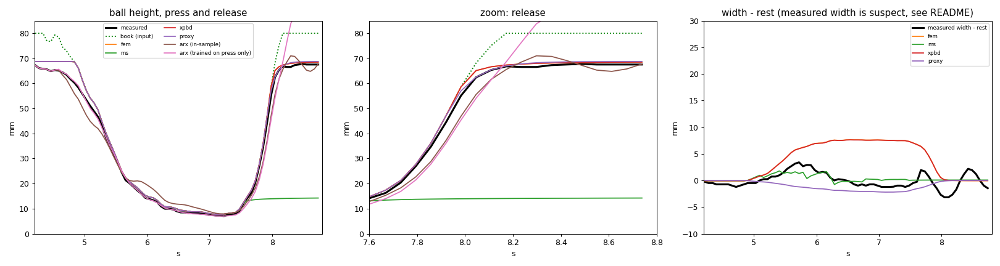
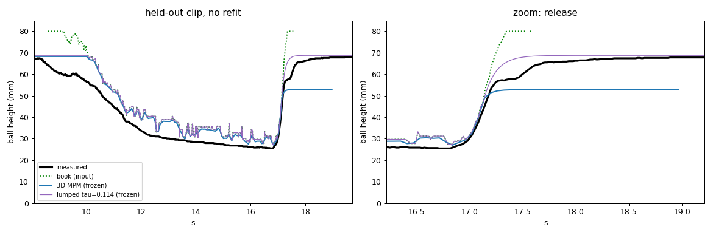
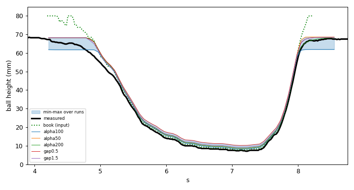

# Learning a soft object's deformation from video

Object: a solid-foam "squishy" ball, diameter 68.7 mm (from a tape-measured 8.5 in **circumference**; `--circ_in` / `--diam_mm` change it).
Interaction: a hardcover book presses the ball flat on a table, holds, then is lifted off by hand. Side-on camera.
Two clips of the same ball and view:

| clip | file | resolution / fps | depth | role |
|---|---|---|---|---|
| 1 | `data/input.mp4` | 848x478, 47.7 | to ~10 % of the ball height (book lifted at up to 0.2 m/s) | model fitting |
| 2 | `data/input2.mp4` | 1256x804, 49.2 | to 37 % of the height (slow press, book lifted at up to 0.24 m/s) | held-out test, **not fitted** |

**Short version of the result.** The 3D simulation follows the ball height during press and release on clip 1 (1.9 mm mean error). Applied unchanged to clip 2 it does
**not** predict the deep squash or the recovery well (height RMSE 4-6 mm). The recovery speed differs between the two clips and two clips cannot say why.
Stiffness is not identified (no force data). Details, and everything that does not work, are below.

## Results at a glance (`results/`)

Everything a reviewer needs to look at is in `results/` (committed); `outputs/` is regenerated by the commands below and is not committed.

| file | what it shows |
|---|---|
| [`results/demo_clip1.mp4`](results/demo_clip1.mp4) | **Main demo, clip 1 (fitted):** real video | simulated ball (oblique) | simulated ball from above. Only the measured book height is fed to the sim |
| [`results/demo_clip2.mp4`](results/demo_clip2.mp4) | **Held-out demo, clip 2:** same layout, same parameters, nothing refitted (the sim is visibly off in depth and recovery speed; see Results) |
| [`results/models_compare.mp4`](results/models_compare.mp4) | clip 1: the real clip next to every model tried (MPM, FEM, XPBD, mass-spring), with each model's height next to the measured one |
| [`results/compare.png`](results/compare.png) | height / width / volume curves of all models and the lumped and ARX baselines (clip 1) |
| [`results/heldout_clip2.png`](results/heldout_clip2.png) | clip 2: measured vs frozen 3D sim vs frozen lumped model |
| [`results/band.png`](results/band.png) | clip 1: spread over damping and contact-gap settings (how much the two hand-set values matter) |
| [`results/baseline_1dof.png`](results/baseline_1dof.png) | the 1-DOF baseline and what a single clip can identify |
| [`results/dots_tracking.png`](results/dots_tracking.png) | tracking of the dots printed on the ball after release (a cross-check on the silhouette; feeds the post-release section) |

### Demo (real video | simulated ball | simulated ball from above)

**Clip 1 (the clip the model was fitted on)**


**Clip 2 (held out, same parameters, nothing refitted)**


**Clip 1, every model tried next to the real clip**


(GIFs are previews; the full-quality mp4s are linked in the table below.)

Click a video name to play it on GitHub. The main figures, inline:

**Clip 1, all models and baselines (height, width, volume ratio)**



**Clip 2, held out (nothing refitted): measured vs 3D sim vs lumped**



**Clip 1, spread over damping and contact-gap settings**



Input videos: `data/input.mp4` (2.5 MB) and `data/input2.mp4` (46 MB) are in the repo, so no external link is needed.

Rebuild `results/` after the runs below:

```bash
mkdir -p results
python render_3d.py outputs/clip1/sim3d_alpha100.npz results/demo_clip1
VIDEO=data/input2.mp4 TARGETS=outputs/clip2/targets.npz CROP=295,995,263,733 python render_3d.py outputs/clip2/sim3d_alpha100.npz results/demo_clip2
python render_compare.py results/models_compare --skip=ms
python extras/track_dots.py --out results/dots_tracking
cp outputs/models/compare.png results/compare.png; cp outputs/clip2/heldout.png results/heldout_clip2.png
for v in demo_clip1 demo_clip2 models_compare; do ffmpeg -y -v error -i results/$v.mp4 -vf "fps=8,scale=800:-1:flags=lanczos,split[a][b];[a]palettegen[p];[b][p]paletteuse" results/$v.gif; done   # GIF previews shown above
cp outputs/clip1/band.png results/band.png; cp outputs/clip1/baseline_1dof.png results/baseline_1dof.png
```
(`render_3d.py` also takes `WOBBLE=1` to overlay the fitted post-release sway as a labelled add-on layer; the demos above do not use it.)

## Files (flat folder, run from here)

| file | what it does |
|---|---|
| `extract_targets.py` | measures a clip (HSV masks): book height (the simulation's input), ball height, silhouette width/area; optional book tilt (`--tilt_half_px`) |
| `lumped.py` | 1-DOF baseline (geometry law, recovery-time scan) and `lumped.py cross`: fit recovery laws on one clip, test on the other |
| `mpm2d.py`, `fit_2d.py` | 2D MPM disc; `fit_2d.py` has `baseline`, `fit`, `sweep` (damping sweep that set alpha = 100) and `plot` |
| `mpm3d.py`, `run_3d.py` | 3D MPM sphere (Taichi MLS-MPM + APIC) driven by the measured book path |
| `mesh_models.py` | alternative 3D models on one tetrahedral mesh: `--model fem | ms | xpbd` |
| `compare.py` | score all models on the same input (`compare.py`) or score a frozen sim on another clip (`compare.py heldout`) |
| `render_3d.py`, `render_compare.py` | videos: real clip next to the 3D sim; real clip next to every model |
| `backend.py` | Taichi start-up (CPU/GPU probe); `python backend.py check` tests a GPU |
| `extras/` | things that did not make the main line: MuJoCo / PyBullet runs, 2D side-by-side demo, post-release sway analysis (dot tracking, sway fit) |

## Run it

```bash
pip install -r requirements.txt            # needs ffmpeg for mp4 output (brew install ffmpeg), otherwise *_raw.mp4 is written

# clip 1 (fitting clip)
python extract_targets.py                  # -> outputs/clip1/targets.npz
python lumped.py                           # lumped baseline + recovery-time scan -> outputs/clip1/baseline_1dof.png
python fit_2d.py sweep                     # (optional, 3 min) damping sweep behind the default alpha = 100
python run_3d.py                           # 3D MPM, ~15 min on 2 CPU threads (MPM_THREADS=8 to speed up) -> outputs/clip1/sim3d_alpha100.npz
python render_3d.py outputs/clip1/sim3d_alpha100.npz outputs/clip1/view3d_clip1        # real | oblique | from above

# clip 2 (held out; same parameters, nothing refitted)
python extract_targets.py --video data/input2.mp4 --out outputs/clip2/targets.npz --xmin 148 --xmax 1125 --rest_frames 120 --ycut 686
python lumped.py cross                     # recovery laws: fit on one clip, test on the other
python run_3d.py --targets outputs/clip2/targets.npz --t0 8.0 --t1 19.0 --out outputs/clip2/sim3d_alpha100.npz     # ~20 min
python compare.py heldout outputs/clip2/sim3d_alpha100.npz outputs/clip2/targets.npz                                 # numbers + outputs/clip2/heldout.png
VIDEO=data/input2.mp4 TARGETS=outputs/clip2/targets.npz CROP=295,995,263,733 python render_3d.py outputs/clip2/sim3d_alpha100.npz outputs/clip2/view3d_clip2

# other models and the comparison (clip 1)
python mesh_models.py --model fem          # ~90 s;  also: --model xpbd (~150 s), --model ms (10 s; collapses, see table)
python compare.py                          # table + outputs/models/compare.png / compare.csv
python render_compare.py --skip=ms         # one video, real clip + each model
```
Outputs go to subfolders (created automatically):

| folder | contents |
|---|---|
| `outputs/clip1/`, `outputs/clip2/` | per clip: `targets.npz` (measurements), `sim3d_*.npz` (3D sim runs), `view3d_*.mp4` (real clip next to the sim), `baseline_1dof.png` (clip 1), `heldout.png` (score of a sim on its own clip) |
| `outputs/models/` | clip-1 comparison of representations: `mesh_*_h4.5.npz`, `compare.png/.csv`, `compare_demo.mp4`, 2D fits |
| `outputs/sway/` | post-release sway analysis (`extras/`) |
| `outputs/logs/` | console logs you saved |

`run_3d.py` saves next to the `--targets` file it was given, and `render_3d.py` saves next to the sim file. `*_raw.mp4` files are what is written when ffmpeg is missing.

CPU only is fine. Pixel-based options (`--xmin/--xmax/--ycut`, `CROP`) depend on the camera framing; the clip-2 values above are for its resolution. `render_3d.py` prints which video, targets
and crop it is using; use VIDEO and TARGETS together. Optional `--tilt` (see below) needs `extract_targets.py ... --tilt_half_px 150`.

## Approach

1. **Measure** (`extract_targets.py`): HSV masks find the yellow ball and the blue book; the ball's rest width in pixels, matched to its measured diameter, gives the scale.
   Outputs: book-underside height (the sim's input), ball height, silhouette width and area.
2. **Lumped baseline** (`lumped.py`): no mesh, no grid; shows what a clip can identify on its own.
3. **3D MPM** (Taichi, MLS-MPM with APIC): fixed-corotated elasticity, Coulomb friction with table and book, mass-proportional (Rayleigh) damping. The book is a kinematic rigid plane following the
   *measured* path. MPM is used because the ball goes to ~10 % of its height, where tetrahedral FEM inverts elements.
4. **Other 3D representations** (`mesh_models.py`): corotated FEM, mass-spring and XPBD on a shared tetrahedral mesh, to see which understands the behaviour. No 3D reconstruction is used (the object is a known sphere).

Nothing in the model replays the video: only the book height is fed in, and the ball's height, width and shape come out of the physics.

### What the video told me, and what I did with it

| Observation in the video | Modelling decision |
|---|---|
| Ball is a near-sphere of known diameter; the silhouette gives its size and the scale | Initial geometry: a sphere of that diameter (no reconstruction needed) |
| The book is the only thing that moves the ball; its height is measured every frame | Kinematic rigid plane driven by that height; the only input |
| Height falls by ~90 % but the visible width grows by only ~1 mm (fitted width law exponent about 0) | A compressible, foam-like solid: Poisson ratio 0 (lambda = 0), so the volume ratio J falls to ~0.35 at deepest squash. Poisson ratio is not tightly identified (varied -0.45..0.3 in 2D with little change in the silhouette), and even so every continuum model still spreads sideways more than the video shows |
| While pressed, the ball stays within 1-2 mm of the book and shows no lag or ringing | Quasi-static press; damping strong enough that the sim has no overshoot (alpha=100, picked by a sweep against that) |
| After release there is no bounce in height, only a smooth return | Overdamped recovery; the time constant is read from the last ~10 mm of the return (about 0.1 s on clip 1, 0.25 s on clip 2) |
| Ball rests on the table and slips little under the book | Coulomb friction (0.5) on both surfaces; set by hand, not fitted |
| Clip 2 (slower, deeper, different press) | Used as a held-out test of the clip-1 parameters, not for fitting |

What the video did **not** identify: absolute stiffness (the silhouette is the same from E/rho 4 to 128, and no force or mass was measured), friction, and any rate-dependent term (no recovery law fitted on one clip transfers to the other). The post-release sway is shown as a fitted overlay, not predicted.

## Results

**Clip 1 (fitted).** Same input, same observables, window 5.0-8.8 s (`compare.py`):

| model | height RMSE press+release (mm) | height RMSE after the book left (mm) | width at deep squash vs measured (mm) | notes |
|---|---|---|---|---|
| 3D MPM | 1.95 | 1.20 | +8.4 | recovers to 68.4 mm (rest 68.7) with no overshoot |
| FEM (corotated tets) | 1.26 | 0.87 | +7.4 | ~1800 transiently inverted tets at deepest squash, recovers |
| XPBD | 1.27 | 0.89 | | similar |
| lumped 1-DOF (tau = 0.1 s) | 1.20 | 1.05 | | |
| mass-spring | 24 | 52 | | collapses (volume ratio ~0.05); dropped from the comparison |
| ARX black box (trained on the press only) | 9.0 | 20.6 | | cannot predict a release it never saw |

https://github.com/user-attachments/assets/d98595d6-98d8-40d1-9a3d-6c2df2b7c828

MPM, FEM and XPBD agree with each other to ~1-2 mm and all spread sideways ~7-9 mm more than the video shows (see Limitations). MuJoCo flex was tried on the same mesh (`extras/`): at deep squash it produced >1000 inverted tets
and seconds of simulated time took hours, so it was not completed. PyBullet deformable was only smoke-tested. Neither is in the table.

**Clip 2 (held out, 37 % depth).** The 3D MPM was run with the clip 1 parameters (E/rho = 8, alpha = 100, friction 0.5, nothing refitted):

| | flat book | tilted book (`--tilt`) |
|---|---|---|
| height RMSE, press | 7.89 mm | 7.94 mm |
| height RMSE, release | 4.89 mm | 4.91 mm |
| height at the press minimum (t = 16.7 s; measured 25.5 mm) | 32.1 mm | 32.2 mm |
| height 0.7 s later (measured 57.8 mm) | 68.0 mm | 68.0 mm |
| width at deep squash, sim - measured | +5.9 mm | +6.6 mm |
| lumped model, tau = 0.114 s frozen from clip 1 (release RMSE) | 3.96 mm | |

https://github.com/user-attachments/assets/d2d9f06d-e148-4cfa-b1bc-2f907852acbb

Both runs cover 8-19 s with the same parameters; the book's 1-3 mm tilt makes no meaningful difference. (An earlier flat run that stopped at ~17.4 s scored differently only because it covered a shorter window.)

https://github.com/user-attachments/assets/41b8904a-40de-4c2a-a2a0-95c37896de61

Where the error comes from (checked against the book height, tilted run; the flat run is nearly identical): the simulated ball **lags the book during the slow press** -- 1.9 mm above the book at 11.5 s, 7.3 mm at 13.0 s (a plateau at ~39.8 mm
while the book keeps lowering), 3.8 mm at 14.0 s, and only ~1 mm from 15.9 s on. A separate test (book lowered to 27.5 mm in 1.5 s and held, no video) leaves the sim ball 0.9 mm above the book, the same offset as on clip 1,
so the grid contact gap itself is fine; the lag is a *transient* problem. The contact is enforced on grid velocities only (no position correction), so material that ends up above the book is not pushed back, which fits the plateau
but was not proven. 
**Tried and rejected:** an optional particle-level projection (`run_3d.py --project`) removes most of the lag at the press (spot test: sim within 0.8 mm of the book) but breaks recovery. Full runs: clip 1 press 2.41 mm / release 7.70 mm, ball stalls at 54.6 mm vs 66.8 mm measured 1 s after the minimum; clip 2 press 6.67 mm (was 7.89) / release 10.73 mm (was 4.89), stalls at 52.9 mm vs 65.5 mm. I tested one explanation: that the jump leaves F inconsistent. `--proj_k` also compresses F in proportion to the jump (clip-1 press and release, 6.2-8.6 s): with k=1 the ball ends at 18.7 mm and with k=3 at 29.2 mm, against ~67 mm measured, and without the compression it stalled at 54.6 mm. So that explanation is wrong, and compressing F made recovery worse. Projection simply removes volume from a ball that is already near the squashed limit, and I did not find a version that keeps recovery. It stays off by default; the numbers in the tables above use the grid-only contact. The "deepest squash" row in the table (31.7 / 32.2 mm vs 25.5 mm) is also inflated by two things: the measured ball height is ~2 mm below the (tilted) book's lowest point, and the sim's minimum
is not at the same instant as the measured one. The sim also **recovers too fast** (measured 57.8 mm at +0.7 s; both sims are at 68 mm). Using the measured tilt changed nothing, so the 1-3 mm tilt is not the explanation. The clip-2 numbers were looked at before the 3D test was run; no parameter was changed in response.

**Recovery laws across the two clips** (`lumped.py cross`, release RMSE in mm; the number after the arrow is on the held-out clip):

| law | fit on 1, test on 2 | fit on 2, test on 1 | fit on both (clip 1 / clip 2) |
|---|---|---|---|
| single tau | 0.98 -> 3.45 | 1.46 -> 3.66 | 1.81 / 2.28 |
| tau depends on compression | 0.98 -> 3.45 | 1.01 -> 3.10 | 1.73 / 1.79 |
| 2nd order (S-shaped) | 1.56 -> 2.42 | 1.91 -> 3.89 | 1.58 / 2.41 |
| Standard linear solid (rate-dependent, 3 params; `lumped.py cross`) | 0.98 -> 3.45 | 1.08 -> 4.04 | 1.89 / 2.18 |

The viscoelastic (SLS) law was tried specifically because the slow press on clip 2 might explain its slower recovery. The fit drove the Maxwell time constant to ~0.001 s on clip 1 and 0.17 s on clip 2 and did not transfer (3.45 / 4.04 mm held-out), so the clips' different recovery is not explained by this rate dependence either.

No law fitted on one clip predicts the other within ~2.4 mm. In both clips the ball stays within ~1-2 mm of the book until the book is ~55-60 mm high, so the recovery constant is only observable in the last ~10 mm after the ball separates
(clip 1: ~0.1 s; clip 2: ~0.25 s). The same clip-2 measurements from the WhatsApp copy and from the original file agree to ~0.3 mm, so this is not a compression artefact. Whether it is depth, release speed, or air flow
back into the foam cannot be decided from two clips.

Parameters in the 3D runs: E/rho = 8 m^2/s^2 (chosen, not fitted), nu = 0, friction 0.5 (not fitted), gravity off, Rayleigh alpha = 100 /s, 3 mm grid, ~50k particles.

## How much do the two hand-set values matter? (clip 1)

`python compare.py band outputs/clip1/targets.npz <runs...>` overlays runs that change only the damping (`--alpha`) or the contact gap (`--gap`); everything else is identical. Height RMSE against the video, from the book's first contact to 2 s after the minimum (this window differs from the one in the comparison table above, so the numbers are not directly comparable to it):

| Run | All | Press | Release |
|---|---|---|---|
| alpha 100, default gap (headline) | 2.61 | 2.26 | 3.26 |
| alpha 50 | 2.81 | 3.05 | 2.18 |
| alpha 200 | 2.73 | 3.10 | 1.66 |
| gap 0.5 mm | 3.42 | 3.68 | 2.73 |
| gap 1.5 mm | 2.75 | 3.00 | 2.06 |

Across the five runs the height differs by 3.1 mm on average (up to 6.7 mm, during the fast release; 1.9 mm at the press minimum). So the headline error is about the same size as the effect of two values I set by hand, and differences of ~1 mm between models or settings should not be over-read. The damping was chosen by a no-overshoot criterion, not by minimising this error: alpha 200 would score better on the release (1.66 mm vs 3.26 mm), at a slightly worse press. The press is the better-constrained phase.

## What the video does and does not identify (read this first)

- **Force is never observed**, and the book's motion is the simulation's *input*, so stiffness is not identified. Only E/rho could be constrained, and only weakly. A dead-weight test (known mass on the ball, record the squash) would identify it; not done.
- **E/rho = 8 is a convenience, not a result.** Soft enough to run quickly, stiff enough that the book is slow compared with the wave speed (quasi-static). Because it is soft, gravity is switched off (with gravity on it sags ~7 mm under its own weight; a real, much stiffer foam would not).
- **Stiffness has almost no effect on what the video shows**, because the book's motion is the input. 2D model on clip 1, alpha = 100, E/rho varied 32-fold (a few seconds of `fit_2d.py`-style runs each):

  | E/rho (m^2/s^2) | 4 | 8 | 32 | 128 |
  |---|---|---|---|---|
  | height RMSE, 5-9 s (mm) | 1.56 | 1.60 | 1.60 | 1.57 |
  | maximum width (mm) | 77.7 | 77.6 | 77.6 | 77.5 |

  The silhouette is the same to within noise, so no value of E/rho can be recovered from it. A force measurement would be needed (a dead-weight or scale test was tried and not possible with the setup available).
- **Damping was tuned, not identified.** With alpha = 2 the simulated ball overshoots to 84 mm after the book leaves; the real ball returns to 68 mm with no bounce. `fit_2d.py sweep` (2D model): alpha 2 / 30 / 100 / 300 give a maximum post-release height of
  84.2 / 70.2 / 69.3 / 69.3 mm. alpha = 100 is the smallest tested value with no bounce beyond measurement noise. It also absorbs air and surface drag, so it is not a material property.
- **Friction and Poisson ratio are not identified** (weak effect on the silhouette).

## Post-release motion (clip 1; partly accounted for)

After the book leaves, the ball's height returns to rest without overshoot. What happens next is mostly a **small sideways sway of the whole ball**, not a change of diameter:

| signal (t >= 8.3 s) | f (Hz) | zeta | amplitude | note |
|---|---|---|---|---|
| ball centroid x | 0.68 | ~0.22 | ~7.5 mm | fit rmse 0.66 mm vs 10.5 mm peak-to-peak |
| edge-to-edge width | 1.7 | ~0.15 | ~3 mm at 8.3 s, ~1 mm by 9 s | small; first dip is the release transient |

Checks: a table-texture strip is steady to < 0.1 mm (not camera shake); net sideways drift 0.3 mm (a true oscillation); no vertical bounce above ~0.3 mm. An elastic sphere's lowest shape mode is ~2.5 c_s / R: ~23 Hz for the
simulated stiffness and > 100 Hz for real foam, so a 0.7 Hz sway is not a foam shape mode; it looks like rigid-body rocking or rolling on the contact patch, probably kicked by the book's lateral motion and tilt as it is lifted by hand.
The MPM does not produce it. `extras/sway_model.py` fits it and `WOBBLE=1 python extras/render_demo.py` (and `render_3d.py`) overlays it on the rendered particles as a labelled whole-ball shift: a descriptive layer, not a prediction.

## Limitations (honest list)

- **Held-out clip fails** (above): the frozen model does not predict deep squash height (+6 mm) or the recovery time. The simplest model (lumped tau) does about as well or better than the 3D sim there.
- **Sideways spread.** At deep squash every continuum model spreads the ball sideways by +6 to +9 mm more than the measured silhouette (which stays within ~5 mm and returns to ~0). It persisted for Poisson ratio -0.3..0.3, friction 0..1, 2 mm vs 1 mm grid, 2D vs 3D.
  Either the model lacks foam physics (air escaping, strongly nonlinear compaction) or the width measurement is biased (the shaded underside is partly missed by the colour mask). Unresolved.
- **The book is a rigid flat plane** following one measured height; the real book is a flexing, tilted hardcover (1-3 mm of tilt across the ball; modelling the tilt did not help). The measured book height is noisy frame to frame (~0.7 mm during the hold); the sim's height
  jitters 2-3 mm there. `--plate_smooth` smooths the input harder but was not used for the numbers above.
- Contact is velocity-level on the grid with a height-dependent gap calibrated in 2D on clip 1 and scaled to 3D. Held static it behaves (0.9 mm offset), but during the slow press on clip 2 the sim ball lags the book by up to 7 mm; a particle-level position correction (`--project`) was tried and reduces the lag but ruins recovery (see Results), so it is left off; a correction that also compresses the deformation gradient (`--proj_k`) was tried and was worse.
- No rate dependence, no permanent set, no densification stiffening; two clips only.
- The post-release sway is a fitted description of one release, not a prediction.
- Camera/lighting: auto-exposure darkens the ball under the book in clip 2; the colour thresholds are hand-set.
- The ball is a known sphere on a known table; nothing here generalises to other shapes without new work (transfer to another shape was not tested).

3D views (`render_3d.py`): the ball surface is the convex hull of the simulated particles, shaded by face normal. The depth direction is simulation only (single camera), so the oblique and top-down panels cannot be checked against data.

## Credits

Taichi (https://taichi-lang.org) for the solver; OpenCV, NumPy, SciPy, Matplotlib; ffmpeg for video encoding. MLS-MPM/APIC follows Hu et al. 2018. MuJoCo and PyBullet were tried as third-party baselines (see above).
Related work read for context (abstract level): PhysTwin, Spring-Gaus, PhysGaussian, GIC, PAC-NeRF, MonoPhysics, EMPM.
Code and analysis were developed with substantial help from Claude (Anthropic) in an interactive session; the videos, the runs on the author's machine, and the choice of what to test are the author's.
